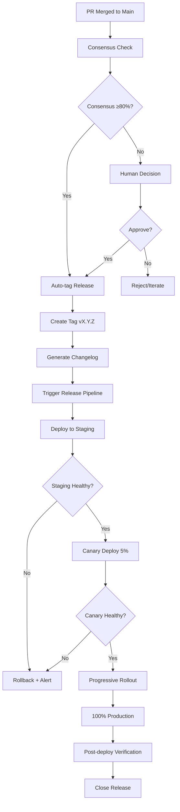

# Release Management — Versioning, Changelogs, Rollback, Post-Release

## Release Philosophy

**Release early, release often, release safely.**

- **Small batches** — Single feature or fix per release when possible
- **Automated gates** — No human gatekeepers for passing releases
- **Observable deployments** — Every release tracked end-to-end
- **Fast rollback** — <5 minutes to revert
- **Blameless postmortems** — Learn from every release

## Versioning Strategy

### Semantic Versioning (SemVer 2.0)
```
MAJOR.MINOR.PATCH[-PRERELEASE][+BUILD]

MAJOR: Incompatible API changes
MINOR: Backward-compatible functionality
PATCH: Backward-compatible bug fixes
PRERELEASE: -alpha, -beta, -rc.1, -rc.2
BUILD: +build.123, +sha.abc123
```

### Version Bump Rules

| Change Type | Version Bump | Example |
|-------------|--------------|---------|
| Breaking API change | MAJOR | 2.0.0 → 3.0.0 |
| New feature (backward compat) | MINOR | 2.3.0 → 2.4.0 |
| Bug fix | PATCH | 2.3.1 → 2.3.2 |
| Security fix | PATCH (+security tag) | 2.3.1 → 2.3.2-security.1 |
| Pre-release | PRERELEASE | 2.4.0-rc.1 |

### Breaking Change Criteria
- API endpoint removed/changed
- Database schema migration required
- Configuration format changed
- Authentication/authorization changes
- Removed public interfaces
- Changed error codes/formats

## Release Types

### Standard Release (Minor/Patch)
```
Trigger: Consensus approval on feature/fix PR
Process: Auto-merge → Tag → Deploy → Verify
Timeline: Minutes after merge
Rollback: Feature flag or git revert
```

### Major Release
```
Trigger: Planned, scheduled
Process: Release branch → RCs → GA tag → Staged rollout
Timeline: Weeks (RC cycle)
Rollback: Full version rollback
```

### Hotfix Release (Patch)
```
Trigger: Production incident
Process: Hotfix branch → Expedited PR → Tag → Emergency deploy
Timeline: <30 minutes
Rollback: Automatic if SLO violation
```

### Pre-release (Alpha/Beta/RC)
```
Trigger: Major feature preview
Process: Release branch → Alpha → Beta → RC → GA
Timeline: 2-4 weeks
Rollback: Pre-release tag only
```

## Release Process

### Standard Release Flow


### Release Pipeline Stages

| Stage | Duration | Checks | Rollback Trigger |
|-------|----------|--------|------------------|
| **Tag Creation** | <1min | Consensus, version format | Manual cancel |
| **Staging Deploy** | 2-5min | Health checks, smoke tests | Auto on failure |
| **Canary (5%)** | 5-10min | Error rate, latency, business metrics | >1% error rate |
| **Progressive (25%)** | 10-20min | SLOs, error budget | Burn rate >2x |
| **Progressive (50%)** | 10-20min | SLOs, error budget | Burn rate >2x |
| **Full (100%)** | 5-10min | SLOs, error budget | Burn rate >1x |
| **Post-deploy** | 5-15min | SLOs, error rate, business metrics | Manual |

## Changelog Management

### Changelog Format (Keep a Changelog)
```markdown
# Changelog

All notable changes to this project will be documented in this file.

The format is based on [Keep a Changelog](https://keepachangelog.com/en/1.0.0/),
and this project adheres to [Semantic Versioning](https://semver.org/spec/v2.0.0.html).

## [Unreleased]

## [2.3.0] - 2026-11-20

### Added
- Real-time notifications with WebSocket and fallback (#2847)
- Dark mode support for dashboard (#2832)
- Export to PDF functionality for reports (#2821)

### Changed
- Improved onboarding flow with interactive tutorial (#2835)
- Updated notification preferences UI (#2840)

### Deprecated
- Legacy REST endpoint `/api/v1/notifications` (use WebSocket)

### Removed
- Deprecated `user.legacy_field` from API response

### Fixed
- Prevent SQL injection in user service (#2851)
- Fix memory leak in notification service (#2849)
- Resolve race condition in payment processing (#2843)

### Security
- Rotate JWT signing keys per ADR-052 (#2850)
- Update dependencies: lodash 4.17.21 → 4.17.22 (#2848)

### Performance
- Reduce p99 latency from 85ms to 47ms (#2845)
- Optimize database queries for user lookup (#2844)

## [2.2.1] - 2026-11-15

### Fixed
- Hotfix: Prevent N+1 query in dashboard loading (#2830)

## [2.2.0] - 2026-11-10
...
```

### Changelog Generation (Automated)
```bash
# From git log since last tag
git log $(git describe --tags --abbrev=0)..HEAD \
  --pretty=format:"- %s (%an)" \
  --no-merges \
  --grep="^feat\|^fix\|^perf\|^security\|^refactor\|^docs\|^test\|^chore" \
  | sort -u
```

### Changelog Categories
| Category | Commit Prefix | Description |
|----------|---------------|-------------|
| `Added` | `feat:` | New features |
| `Changed` | `feat:`, `refactor:` | Changes to existing functionality |
| `Deprecated` | `feat:`, `chore:` | Soon-to-be-removed features |
| `Removed` | `feat:`, `refactor:` | Removed features |
| `Fixed` | `fix:` | Bug fixes |
| `Security` | `security:` | Security fixes |
| `Performance` | `perf:` | Performance improvements |
| `Dependencies` | `chore:`, `build:` | Dependency updates |

## Release Automation

### GitHub Actions Release Workflow
```yaml
# .github/workflows/release.yml
name: Release

on:
  push:
    tags:
      - 'v*'

jobs:
  release:
    runs-on: ubuntu-latest
    steps:
      - uses: actions/checkout@v4
        with:
          fetch-depth: 0

      - name: Generate changelog
        id: changelog
        run: |
          PREV_TAG=$(git describe --tags --abbrev=0 HEAD^)
          git log ${PREV_TAG}..HEAD --pretty=format:"- %s (%an)" --no-merges > changelog.md

      - name: Create GitHub Release
        uses: softprops/action-gh-release@v1
        with:
          tag_name: ${{ github.ref_name }}
          body_path: changelog.md
          draft: false
          prerelease: ${{ contains(github.ref_name, '-rc') || contains(github.ref_name, '-beta') || contains(github.ref_name, '-alpha') }}

      - name: Trigger Deploy
        run: |
          gh workflow run deploy.yml -f version=${{ github.ref_name }} -f environment=production
```

### Release Notes Template
```markdown
# Release v2.3.0

## 🎯 Highlights
- **Real-time Notifications**: WebSocket + fallback for instant updates
- **Dark Mode**: Full dashboard support with system preference detection
- **Performance**: 45% latency reduction across API endpoints

## 📦 What's New
### Features
- Real-time notifications with WebSocket + HTTP fallback (#2847)
- Dark mode for dashboard with system sync (#2832)
- PDF export for reports (#2821)

### Improvements
- Onboarding tutorial now interactive (#2835)
- Notification preferences redesigned (#2840)
- Dashboard load time improved 45% (#2845)

## 🐛 Bug Fixes
- SQL injection prevention in user service (#2851)
- Memory leak in notification service (#2849)
- Race condition in payments (#2843)

## 🔒 Security
- JWT key rotation automated (ADR-052) (#2850)
- Dependency updates: lodash 4.17.21→4.17.22 (#2848)

## ⚡ Performance
- API p99 latency: 85ms → 47ms (-45%)
- Dashboard load: 1.2s → 650ms (-46%)
- Memory usage: 240MB → 180MB (-25%)

## 📋 Migration Guide
No breaking changes in this release.

## 🔗 Links
- [Full Changelog](CHANGELOG.md)
- [API Docs](https://api.example.com/docs)
- [Upgrade Guide](https://docs.example.com/upgrade/v2.3.0)
```

## Rollback Procedures

### Automatic Rollback Triggers
| Trigger | Action | Time |
|---------|--------|------|
| SLO burn rate > 2x | Auto-rollback to previous version | <2 min |
| Error rate > 1% | Auto-rollback | <2 min |
| Latency p99 > 2x budget | Auto-rollback | <2 min |
| Business metric anomaly | Alert → Human decision | <5 min |
| Failed health checks | Auto-rollback | <1 min |

### Rollback Methods

#### 1. Feature Flag (Preferred - Zero Downtime)
```bash
# Disable feature flag
launchdarkly flag update realtime-notifications --off

# Verify recovery
# Metrics should normalize within minutes
```

#### 2. Git Revert (Code-Level)
```bash
# Revert merge commit
git revert <merge-commit-sha> -m 1
git push origin main

# Triggers CI/CD → automatic redeploy of previous version
```

#### 3. Full Tag Rollback (Emergency)
```bash
# Force push previous tag
git push --force-with-lease origin v2.2.1:main

# Or reset and force push
git checkout v2.2.1
git push --force-with-lease origin HEAD:main
```

#### 4. Database Rollback (If Schema Changed)
```bash
# Run down migration
kubectl exec -it deploy/migration-runner -- \
  migrate -path /migrations -database $DB_URL down 1

# Verify data integrity
```

### Rollback Decision Matrix
| Scenario | Method | Time | Data Risk |
|----------|--------|------|-----------|
| Feature bug, flag exists | Feature flag | <1 min | None |
| Bug in code, no flag | Git revert | 2-5 min | Low |
| Major regression, unknown cause | Git revert | 2-5 min | Low |
| Schema migration issue | DB rollback + code revert | 5-15 min | Medium |
| Unknown cause, widespread | Full tag rollback | 2-5 min | Low |
| Data corruption | DB restore + code rollback | 15-60 min | High |

## Post-Release Activities

### Immediate (0-30 min)
- [ ] Verify all SLOs healthy
- [ ] Check error rates, latency, throughput
- [ ] Verify business metrics (signups, revenue, engagement)
- [ ] Confirm feature flags working
- [ ] Notify stakeholders

### Short-term (30 min - 4 hours)
- [ ] Monitor error budgets
- [ ] Review user feedback/support tickets
- [ ] Check third-party integrations
- [ ] Verify backup/restore points created

### Medium-term (4 hours - 24 hours)
- [ ] Post-deployment review meeting
- [ ] Update runbooks if needed
- [ ] Document any issues/learnings
- [ ] Plan next release

### Long-term (1 week)
- [ ] Blameless postmortem (if incidents)
- [ ] Update runbooks/playbooks
- [ ] Retrospective on release process
- [ ] Plan improvements for next cycle

## Release Communication

### Internal
- **Slack #releases**: Automated notification with link
- **Email**: Stakeholder summary (major releases)
- **Dashboard**: Release status in Grafana

### External
- **Changelog**: Published to docs site
- **In-app notification**: For user-facing features
- **Blog post**: Major releases only
- **Social media**: Major releases only

## Release Metrics

### Leading Indicators (Pre-release)
- PR cycle time
- Test coverage
- Security scan results
- Performance baseline
- Architecture review score

### Lagging Indicators (Post-release)
- Deployment frequency
- Lead time for changes
- Mean time to recovery (MTTR)
- Change failure rate
- Customer-reported issues
- Rollback rate

### Target Metrics (DORA Elite)
| Metric | Target |
|--------|--------|
| Deployment frequency | On-demand (multiple/day) |
| Lead time for changes | <1 hour |
| MTTR | <1 hour |
| Change failure rate | <5% |
| Rollback rate | <2% |

## Release Checklist

### Pre-release
- [ ] All validation gates passed
- [ ] Consensus reached (≥80%)
- [ ] Human approval for production
- [ ] Changelog generated
- [ ] Release notes drafted
- [ ] Runbook updated
- [ ] Rollback plan documented
- [ ] Feature flags configured
- [ ] Monitoring alerts configured
- [ ] Stakeholders notified

### During Release
- [ ] Tag created and pushed
- [ ] Staging deploy successful
- [ ] Canary metrics healthy
- [ ] Progressive rollout on track
- [ ] SLOs within budget
- [ ] No error budget burn

### Post-release
- [ ] 100% rollout complete
- [ ] Post-deploy verification passed
- [ ] Changelog published
- [ ] Release notes published
- [ ] Stakeholders notified
- [ ] Runbooks updated
- [ ] Retrospective scheduled (if needed)