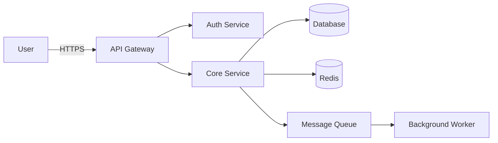

# Threat Model: [System/Component Name]

## Overview
- **System**: [Name]
- **Owner**: [Team/Person]
- **Date**: [YYYY-MM-DD]
- **Version**: [1.0]
- **Reviewers**: [Names]

## Data Flow Diagram (DFD)

## Trust Boundaries
| Boundary | Description | Controls |
|----------|-------------|----------|
| Internet → API Gateway | Public ingress | WAF, Rate limiting, TLS 1.2+ |
| API Gateway → Services | Internal network | mTLS, JWT validation |
| Services → Database | Data layer | Parameterized queries, least privilege |
| Services → Queue | Async processing | Message signing, dead letter queue |

## STRIDE Analysis

| Component | Spoofing | Tampering | Repudiation | Info Disclosure | DoS | Elevation of Privilege |
|-----------|----------|-----------|-------------|-----------------|-----|------------------------|
| API Gateway | JWT validation | Request signing | Audit logs | Rate limiting | Rate limiting | RBAC |
| Auth Service | MFA, strong passwords | Signed tokens | Immutable logs | Encrypted secrets | Account lockout | Privilege separation |
| Core Service | Service mesh mTLS | Input validation | Audit trail | Field-level encryption | Circuit breaker | Least privilege |
| Database | Service accounts | Row-level security | Audit triggers | TDE, column encryption | Connection pooling | Role separation |

## Threat Scenarios

| ID | Threat | STRIDE | Likelihood | Impact | Risk | Mitigation |
|----|--------|--------|------------|--------|------|------------|
| T-01 | SQL Injection via API | Tampering | Medium | High | High | Parameterized queries, SAST, WAF |
| T-02 | JWT Secret Leakage | Info Disclosure | Low | Critical | High | Vault rotation, short expiry, no logging |
| T-03 | Cache Stampede | DoS | Medium | Medium | Medium | Singleflight, staggered TTL |
| T-04 | Privilege Escalation via Broken Auth | Elevation | Low | Critical | High | RBAC, integration tests, chaos testing |

## Mitigations Status
- [ ] Parameterized queries enforced (SAST rule)
- [ ] Secrets in Vault with rotation
- [ ] Singleflight for cache misses
- [ ] RBAC tested in CI

## Residual Risk
[Document accepted risks with owner and review date]

## Next Review
[Date or trigger event]